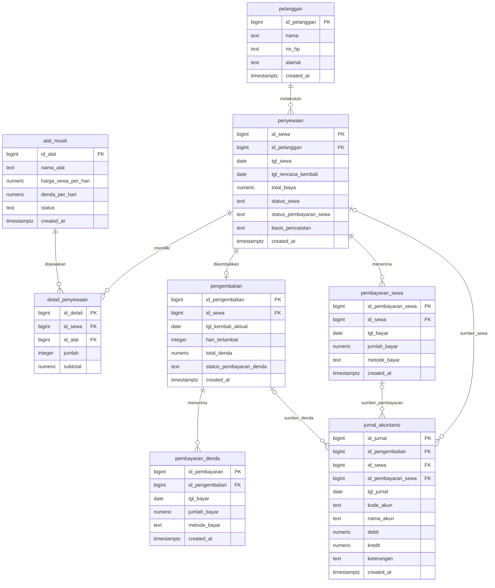

# Ritme — Sistem Informasi Rental Alat Musik

**Ritme** adalah aplikasi web untuk membantu penjual mengelola usaha rental alat musik. Aplikasi mencatat pelanggan, inventaris, transaksi penyewaan, pengembalian, pembayaran sewa dan denda, serta menyajikan jurnal umum, buku besar, dan laporan pendapatan.

> Proyek ini dibuat sebagai aplikasi demo/tugas akademik. Data tersimpan di Supabase.

## Tautan proyek

- **Repository GitHub:** [ayugirsang/RENTAL-MUSIK](https://github.com/ayugirsang/RENTAL-MUSIK)
- **Aplikasi demo:** [ayugirsang.github.io/RENTAL-MUSIK](https://ayugirsang.github.io/RENTAL-MUSIK/)

Repository berisi kode sumber, skema database, panduan, dan konfigurasi deployment. Tautan demo digunakan untuk mencoba aplikasinya.

## Fitur

| Menu/fitur | Penjelasan |
| --- | --- |
| **Dashboard** | Menampilkan pendapatan dan kas diterima bulan ini, piutang terakru, penyewaan aktif, alat tersedia, jadwal jatuh tempo, keterlambatan, tren pendapatan harian, serta tindak lanjut operasional. |
| **Pelanggan** | Menambahkan dan memilih pelanggan untuk transaksi rental. |
| **Inventaris alat musik** | Menyediakan contoh gitar, bass, keyboard, drum, mikrofon, biola, ukulele, cajon, saksofon, trompet, seruling, ampli, dan speaker. Penjual dapat menambahkan alat beserta tarif sewa dan denda per hari. Pilihan alat dilengkapi ilustrasi vektor. |
| **Penyewaan** | Membuat penyewaan dari alat yang tersedia. Biaya dihitung dari tarif harian dan lama penyewaan. Alat yang dipilih berubah menjadi berstatus disewa. |
| **Pengembalian** | Mencatat tanggal kembali, menghitung keterlambatan dan denda secara otomatis, menyelesaikan penyewaan, dan mengembalikan status alat menjadi tersedia. |
| **Pembayaran sewa** | Mencatat penerimaan tunai, transfer, atau QRIS. Pembayaran dapat dicicil; sistem menghitung sisa tagihan dan mencegah pembayaran melebihi saldo. |
| **Pembayaran denda** | Mencatat pelunasan atau cicilan denda dengan validasi sisa tagihan, pilihan metode pembayaran, dan riwayat pembayaran. |
| **Pelanggan & inventaris** | Menampilkan daftar pelanggan, riwayat rental dan pembayaran sewa/denda, performa alat, serta laporan denda berdasarkan periode. |
| **Jurnal umum** | Menghasilkan jurnal debit/kredit secara otomatis saat rental dibuat, pengembalian menimbulkan denda, dan pembayaran sewa atau denda diterima. |
| **Buku besar** | Menelusuri mutasi, saldo awal, debit, kredit, dan saldo berjalan per akun dengan filter periode dan ekspor CSV. |
| **Laporan pendapatan** | Merangkum pendapatan sewa dan denda yang diakui, dibandingkan dengan kas yang benar-benar diterima, per bulan dan rentang tanggal; tersedia ekspor CSV. |

### Alur rental dan pencatatan akuntansi

1. Rental baru menghitung nilai sewa dari tarif alat dan lama penyewaan, lalu mencatat tagihan sebagai piutang sewa dan pendapatan sewa.
2. Pembayaran sewa, baik penuh maupun cicilan, menambah kas dan mengurangi piutang sewa.
3. Saat alat dikembalikan, aplikasi menghitung denda dari hari keterlambatan dan tarif denda setiap alat. Denda menjadi piutang dan pendapatan denda.
4. Pembayaran denda menambah kas dan mengurangi piutang denda.
5. Status pembayaran diperbarui sesuai jumlah yang sudah diterima: **Belum Lunas**, **Sebagian**, atau **Lunas**.

| Peristiwa | Debit | Kredit |
| --- | --- | --- |
| Rental dicatat | Piutang Sewa (1120) | Pendapatan Sewa Alat Musik (4100) |
| Pembayaran sewa diterima | Kas (1110) | Piutang Sewa (1120) |
| Denda diakui saat pengembalian | Piutang Denda (1130) | Pendapatan Denda Keterlambatan (4110) |
| Pembayaran denda diterima | Kas (1110) | Piutang Denda (1130) |

**Pendapatan tidak sama dengan kas diterima.** Dashboard dan laporan menampilkan keduanya terpisah: nilai rental/denda yang diakui berasal dari jurnal pendapatan, sedangkan kas diterima hanya menjumlah pembayaran yang benar-benar dicatat.

**Data rental sebelum fitur pembayaran sewa:** status pembayarannya diinisialisasi sebagai **Belum Dicatat**, bukan dianggap lunas atau belum lunas. Pembayaran yang dimasukkan setelah migrasi untuk rental lama menggunakan basis kas, sehingga penerimaan tersebut tidak membuat saldo piutang akrual yang tidak memiliki catatan awal.

## Entity Relationship Diagram (ERD)

ERD berikut menggambarkan tabel, primary key (PK), foreign key (FK), dan relasi pada skema Supabase aplikasi.



Satu penyewaan dapat berisi beberapa alat melalui `detail_penyewaan`. Pengembalian dibatasi maksimal satu untuk setiap penyewaan. Tabel jurnal menyimpan baris debit/kredit dan dapat merujuk ke penyewaan, pengembalian, atau pembayaran sewa sesuai transaksi sumbernya.

## Teknologi

- **Frontend:** HTML, CSS, JavaScript (tanpa framework)
- **API/server lokal:** Node.js dan Express
- **Database:** Supabase PostgreSQL
- **Hosting demo:** GitHub Pages
- **Pemeriksaan otomatis:** GitHub Actions

Di GitHub Pages, frontend mengakses Supabase langsung menggunakan publishable key yang disediakan melalui konfigurasi GitHub Actions. Pada mode server, aplikasi menggunakan Express sebagai API.

## Menjalankan secara lokal

### Persiapan

- Node.js dan npm
- Project Supabase

### Langkah

1. Clone repository dan masuk ke folder proyek:

   ```powershell
   git clone https://github.com/ayugirsang/RENTAL-MUSIK.git
   cd RENTAL-MUSIK
   ```

2. Pasang dependensi:

   ```powershell
   npm install
   ```

3. Buat file `.env` berdasarkan `.env.example`, lalu isi konfigurasi Supabase:

   ```env
   SUPABASE_URL=https://YOUR_PROJECT.supabase.co
   SUPABASE_PUBLISHABLE_KEY=YOUR_SUPABASE_PUBLISHABLE_KEY
   PORT=3000
   ```

4. Untuk database baru, jalankan [`backend/database/schema.sql`](./backend/database/schema.sql) melalui Supabase SQL Editor. Skrip ini membuat tabel, fungsi, trigger, kebijakan demo, dan inventaris contoh.

5. Jalankan server dari root repository dan buka [http://localhost:3000](http://localhost:3000):

   ```powershell
   npm start
   ```

Jika database sudah ada, jalankan [`backend/database/migrations/20261011_add_rental_payment_accounting.sql`](./backend/database/migrations/20261011_add_rental_payment_accounting.sql) **sekali** melalui Supabase SQL Editor sebelum menggunakan versi aplikasi ini. Migrasi menambahkan tabel pembayaran sewa dan kolom jurnal; rental lama ditandai **Belum Dicatat** agar histori yang tidak diketahui tidak diasumsikan sudah dibayar.

Untuk menambahkan delapan instrumen contoh ke database yang sudah pernah dibuat, jalankan sekali [`backend/database/migrations/20261008_add_more_instruments.sql`](./backend/database/migrations/20261008_add_more_instruments.sql) melalui Supabase SQL Editor. Migrasi tersebut tidak menggandakan alat dengan nama yang sama.

## Pemeriksaan proyek

```powershell
npm test
node --check frontend\js\app.js
git diff --check
```

## Deployment GitHub Pages

Repository ini memiliki workflow **Deploy GitHub Pages**. Untuk menyiapkan deployment:

1. Tambahkan repository secrets `SUPABASE_URL` dan `SUPABASE_PUBLISHABLE_KEY` melalui **Settings → Secrets and variables → Actions**.
2. Pastikan GitHub Pages menggunakan source **GitHub Actions** di **Settings → Pages**.
3. Push perubahan ke branch `main`; workflow akan membangun konfigurasi frontend dan menerbitkan situs.

URL demo proyek: <https://ayugirsang.github.io/RENTAL-MUSIK/>.

## Struktur repository

```text
backend/
  api/
    app.js                              API Express
  database/
    schema.sql                          Skema, fungsi, trigger, dan data contoh Supabase
    migrations/                         Migrasi database Supabase
frontend/
  index.html                            Halaman utama aplikasi
  css/
    style.css                           Tampilan aplikasi
  img/
    logo.svg                            Logo aplikasi
  js/
    app.js                              Logika aplikasi dan integrasi data
    config.example.js                   Contoh konfigurasi Supabase frontend
.github/workflows/                      Pemeriksaan dan deployment otomatis
index.html                              Pengalih ke frontend/ untuk hosting root statis
package.json, package-lock.json         Dependensi dan perintah proyek
.env.example                            Contoh konfigurasi server lokal
```

## Batasan keamanan demo

Aplikasi ini belum menggunakan login. Kebijakan pada [`backend/database/schema.sql`](./backend/database/schema.sql) dan migrasi demo mengizinkan akses data melalui role Supabase `anon` agar aplikasi akademik dapat dicoba. Catatan pembayaran sewa hanya dapat dibaca dan ditambahkan dari aplikasi agar histori jurnalnya tidak dapat diubah atau dihapus melalui client. **Jangan gunakan konfigurasi ini untuk menyimpan data usaha nyata atau data sensitif.** Untuk penggunaan produksi, tambahkan autentikasi Supabase dan batasi Row Level Security (RLS) sesuai peran pengguna.

Jangan pernah memasukkan `service_role` key atau file `.env` ke repository, frontend, maupun konfigurasi publik.
